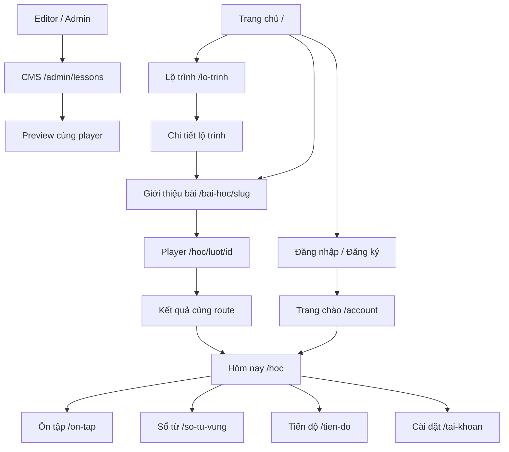

# Một Chút English — Website hiện tại và tài liệu đầu vào redesign

> Ghi chú 24/10/2026: tài liệu này mô tả bản PHP (tag `php-final`), không phải app Next.js hiện tại. Các đường dẫn tới `application/`, `assets/`, `database/` bên dưới nay tương ứng với `app/` + `src/components` (màn hình), `public/assets` (CSS, JS, font), `src/db/schema` (dữ liệu), `seed/` và `templates/`; API xem [api.md](api.md).

> Cập nhật: **22/10/2026**. Tài liệu mô tả code và hành vi hiện tại để phục vụ thiết kế lại giao diện. Đây không phải mô tả một sản phẩm đã hoàn thành toàn bộ spec. Phần đề xuất hoặc cần backend mới được ghi riêng.

## Mục lục

- [1. Tổng quan sản phẩm và thuật ngữ](#1-tổng-quan-sản-phẩm-và-thuật-ngữ)
- [2. Vai trò và cấu trúc điều hướng](#2-vai-trò-và-cấu-trúc-điều-hướng)
- [3. Danh mục route](#3-danh-mục-route)
- [4. Chi tiết màn hình public](#4-chi-tiết-màn-hình-public)
- [5. Chi tiết khu vực học viên](#5-chi-tiết-khu-vực-học-viên)
- [6. Lesson player và kết quả](#6-lesson-player-và-kết-quả)
- [7. Tài khoản và xác thực](#7-tài-khoản-và-xác-thực)
- [8. CMS quản trị](#8-cms-quản-trị)
- [9. Các hành trình người dùng](#9-các-hành-trình-người-dùng)
- [10. Components, trạng thái và responsive](#10-components-trạng-thái-và-responsive)
- [11. Hướng dẫn redesign và ràng buộc kỹ thuật](#11-hướng-dẫn-redesign-và-ràng-buộc-kỹ-thuật)
- [12. Giới hạn hiện tại](#12-giới-hạn-hiện-tại)
- [13. Danh sách màn hình nên bàn giao](#13-danh-sách-màn-hình-nên-bàn-giao)
- [14. File nguồn tham chiếu](#14-file-nguồn-tham-chiếu)

---

## 1. Tổng quan sản phẩm và thuật ngữ

### 1.1 Sản phẩm dùng để làm gì?

Một Chút English là website tự học tiếng Anh cho người Việt, ưu tiên người mới bắt đầu hoặc muốn củng cố nền tảng. Vòng sử dụng chính:

**Chọn mục tiêu → chọn lộ trình → học bài ngắn → làm bài tập → xem giải thích → lưu từ/kiến thức cần ôn → quay lại ôn theo lịch.**

Website có khu vực học cho khách/học viên và khu vực biên tập/vận hành cho editor/admin. Hệ thống học mới lưu dữ liệu trên server cùng tài khoản. Một số trang học cũ vẫn được giữ và sử dụng dữ liệu/trạng thái trình duyệt.

### 1.2 Định hướng nội dung và giọng điệu

- Tiếng Việt cho điều hướng, hướng dẫn và giải thích; tiếng Anh cho nội dung luyện tập.
- Mục tiêu biên soạn khoảng 5–15 phút/bài, không phải thời hạn bắt buộc.
- Thông điệp hiện tại: “Hôm nay một chút. Ngày mai tự tin hơn.”
- Không giới hạn quyền học bằng hearts/energy, tiền ảo hoặc số lần sai.
- XP là ghi nhận hoạt động, không phải năng lực tiếng Anh.
- Bài kiểm tra gợi ý không cấp chứng chỉ CEFR hoặc dự đoán điểm TOEIC.
- Không có thanh toán thật, AI tutor, chấm phát âm, teacher dashboard hoặc leaderboard trong bản hiện tại.

### 1.3 Nội dung có thể dùng để prototype

Theo dữ liệu đã kiểm tra trong đợt audit 21/10/2026:

| Nội dung | Hiện trạng |
|---|---|
| Lộ trình công khai | 2 lộ trình có nội dung |
| Bài học/checkpoint trong lộ trình | 15 bài công khai, gồm 4 checkpoint |
| Kiểm tra gợi ý | 1 bộ 20 câu, ngoài 15 bài trên |
| Từ vựng | 40 nghĩa từ, 4 bộ/chủ đề |
| Kiến thức | 3 bài viết |
| Nghe trong hệ thống mới | Có bản nháp, chưa có audio hợp lệ để xuất bản |
| SMTP và analytics ngoài | Chưa cấu hình trong local đã audit |

Đây là nội dung mẫu thật để trải nghiệm, chưa phải khóa học toàn diện. Không trình bày các lộ trình mở rộng chưa có bài như một sản phẩm sẵn sàng.

### 1.4 Thuật ngữ cần thống nhất

| Thuật ngữ | Nghĩa trong website |
|---|---|
| Lộ trình / path | Nhóm nội dung theo mục tiêu |
| Chương / unit | Nhóm bài trong một lộ trình |
| Bài học / lesson | Mục tiêu + nội dung + bài tập |
| Checkpoint | Kiểm tra ngắn theo chương; không khóa quyền học tiếp |
| Phiên bản | Bản nội dung ổn định cho attempt và lịch sử |
| Lượt học / attempt | Một lần bắt đầu và thực hiện bài |
| Hoàn thành | Đã qua nội dung bắt buộc và kết thúc bài tập bắt buộc |
| Đạt | Đạt ngưỡng điểm khách quan, thường mặc định 80% trong mẫu |
| Tự đánh giá | Đối chiếu đáp án mẫu/tiêu chí; không có điểm chính xác tự động |
| Thẻ ôn | Từ hoặc concept trong lịch ôn cá nhân |
| XP / cấp hoạt động | Ghi nhận hoạt động, khác level nội dung A1/A2/B1 |
| Xu | Chỉ mua vật phẩm trang trí |
| Vé nghỉ | Có thể bảo vệ streak; không tạo ngày thực học hoặc XP |

## 2. Vai trò và cấu trúc điều hướng

### 2.1 Vai trò

| Vai trò | Có thể làm | Giới hạn cần phản ánh trong UI |
|---|---|---|
| Khách | Xem public/catalog/kiến thức, học thử bài bật preview | Muốn lưu vào account phải đăng nhập và xác nhận chuyển bài thử |
| Học viên | Học, ôn, lưu progress/notes, đặt mục tiêu, quản lý account | Chỉ dữ liệu của mình, không có CMS |
| Editor | Draft, preview, gửi duyệt, media, báo lỗi | Không đổi role hoặc publish lesson như admin |
| Admin | Publish/archive/restore, roles, settings, audit, operations | Không có impersonation hoặc nút tự do sửa điểm học viên |

Server vẫn kiểm quyền; ẩn nút không thay authorization. Các workflow ngoài lesson còn có điểm cần hoàn thiện, xem mục 12.

### 2.2 Ba nhóm giao diện

| Nhóm | Mục tiêu | Hướng thiết kế phù hợp |
|---|---|---|
| Public/marketing | Hiểu sản phẩm, khám phá, thử trước khi đăng ký | Header gọn, nội dung SSR, CTA rõ |
| Learning workspace | Học đều, tiếp tục bài, ôn và theo dõi cá nhân | Navigation nhất quán, CTA học/ôn ưu tiên |
| Admin workspace | Biên tập, duyệt, vận hành | Sidebar/menu riêng, bảng, filter, form, workflow |

### 2.3 Header/footer hiện tại

Sau cập nhật giao diện theo Lovable ngày 21/10/2026: header khách gồm logo/wordmark, **Lộ trình – Từ vựng – Kiến thức – Kiểm tra gợi ý**, đăng nhập và CTA Học thử. Khi đăng nhập, menu chính là **Hôm nay – Lộ trình – Ôn tập – Tài khoản**. Mobile có menu riêng, giữ đăng nhập/đăng ký hoặc đăng xuất và đường CMS cho staff.

Trang sản phẩm còn có navigation phụ: **Hôm nay – Lộ trình – Ôn tập – Sổ từ – Tiến độ – Tìm kiếm – Tài khoản**. Hai lớp menu đang lặp một phần; có thể gom lại khi redesign.

Footer: Lộ trình, Bài học cũ, Kiến thức, Giới thiệu, Liên hệ, Điều khoản, Quyền riêng tư; social link nếu đã cấu hình.

## 3. Danh mục route

### 3.1 Quy ước

- `{slug}`: chữ thường, số, gạch ngang; phải tồn tại và được phép xem.
- `{id}` của lượt học/file export: chuỗi hex 32 ký tự, không phải số bài.
- `{number}`: ID số nội bộ, thường ở CMS/media/hệ thống cũ.
- Các route trang sản phẩm dùng GET hiển thị; nhiều form POST về chính URL đang mở với `command`, sau đó redirect.
- API có prefix `/api/v1/`. Không đưa prefix hoặc internal IDs lên nhãn UI người học.
- “Public” không đồng nghĩa mọi draft hoặc tài nguyên archived đều truy cập được.

### 3.2 Public và khám phá

| Route | Màn hình/chức năng | Quyền/tham số |
|---|---|---|
| `/` | Trang chủ mới | Public |
| `/lo-trinh` | Danh sách path khả dụng | Public; chỉ path có nội dung |
| `/lo-trinh/{slug}` | Chi tiết path, chương/bài/progress | Public; progress cá nhân khi login |
| `/bai-hoc/{slug}` | Giới thiệu trước khi bắt đầu | Public; CTA theo preview/login |
| `/tu-vung` | Bộ từ và nghĩa từ công khai | Public; `?page=2`… |
| `/tu-vung/{slug}` | Một nghĩa từ | Public |
| `/tu-vung/chu-de/{slug}` | Từ thuộc bộ/chủ đề | Public; `?page=2`… |
| `/kien-thuc` | Danh sách bài kiến thức | Public; `?page=2`… |
| `/kien-thuc/{slug}` | Một bài kiến thức | Public |
| `/tim-kiem` | Tìm bài/từ/bài viết | Public; `?q=hello` |
| `/kiem-tra-dau-vao` | Giới thiệu kiểm tra gợi ý | Public; học thử theo cấu hình bài |
| `/chien-dich/{pathSlug}` | Landing gắn path khả dụng | UTM allowlist, opt-in, báo cáo journey tại CMS |
| `/gioi-thieu` | Giới thiệu sản phẩm | Public |
| `/lien-he` | Hướng dẫn liên hệ/báo lỗi | Email từ settings nếu có |
| `/dieu-khoan` | Điều khoản | CMS text hoặc bản thông tin ban đầu |
| `/bao-mat` | Quyền riêng tư | CMS text hoặc bản thông tin ban đầu |

### 3.3 Học viên

| Route | Màn hình/chức năng | Quyền/ghi chú |
|---|---|---|
| `/hoc` | Dashboard “Hôm nay” | Đăng nhập; khác `/dashboard` cũ |
| `/hoc/luot/{id}` | Player hoặc kết quả đã finish | Owner/guest session đúng; staff preview cũng dùng |
| `/bat-dau` | Onboarding/mục tiêu | Đăng nhập; có thể bỏ qua |
| `/on-tap` | Thẻ đến hạn | Đăng nhập; có daily limit |
| `/on-tap?more=1` | Ôn thêm tự nguyện | Chỉ thẻ đến hạn |
| `/on-tap?manage=1` | Quản lý thẻ | Phân trang 30 mục/trang |
| `/so-tu-vung` | Sổ từ/notes | `q`, `filter=all/review/hidden` |
| `/tien-do` | Điểm, hoạt động, badges, streak calendar | Có thống kê tuần và lịch sử lượt học phân trang |
| `/tai-khoan` | Cài đặt đầy đủ | Mục tiêu, bảo mật, nhắc học, privacy, export/delete |
| `/reward-shop` | Shop trang trí | Xu ảo; không có thanh toán thật |

### 3.4 Auth và email

| Route | Chức năng | Lưu ý |
|---|---|---|
| GET/POST `/login` | Đăng nhập | Email/password, lỗi/rate limit |
| GET/POST `/register` | Đăng ký | Tên/email/password/confirm |
| GET `/account` | Trang chào/thông tin cơ bản | Khác `/tai-khoan`; CTA vào `/hoc` |
| POST `/logout` | Đăng xuất | Form có CSRF; không logout bằng GET |
| `/quen-mat-khau` | Request reset | Thông báo chung, không tiết lộ email tồn tại |
| `/dat-lai-mat-khau#token=…` | Password mới | Loading/token hết hạn/đã dùng |
| `/xac-minh-email#token=…` | Xác minh email mới/hiện tại | JS đọc token rồi xóa fragment hiển thị |
| `/huy-nhac-hoc#token=…` | Unsubscribe từ email | Loading/success/error |

Không dùng token thật trong prototype, screenshot hoặc URL demo.

### 3.5 CMS mới

GET hiển thị, POST form thao tác; `?pageNo=2` là phân trang CMS. Nhiều form entity dùng `?edit={number}`.

| Route | Chức năng | Quyền chính |
|---|---|---|
| `/admin/paths` | Lộ trình | Editor/Admin |
| `/admin/units` | Chương | Editor/Admin; archive theo quyền |
| `/admin/lessons` | Lesson versions/workflow | Editor/Admin; publish admin |
| `/admin/questions` | Tra cứu câu hỏi trong versions | Editor/Admin |
| `/admin/vocabulary` | Nghĩa từ | Editor/Admin |
| `/admin/vocabulary-sets` | Bộ từ/membership | Editor/Admin; published có giới hạn quyền |
| `/admin/articles` | Bài viết/bản thảo | Editor/Admin |
| `/admin/media` | Upload/thư viện ảnh/audio | Editor/Admin |
| `/admin/imports` | Template/dry-run/import/export | Editor/Admin |
| `/admin/reports` | Báo lỗi và xử lý | Editor/Admin |
| `/admin/users` | Accounts/role | Admin |
| `/admin/settings` | Settings an toàn | Admin |
| `/admin/audit` | Nhật ký | Admin |
| `/admin/operations` | Events/cohort/jobs/retry | Admin |
| `/admin/lesson-preview/{number}` | Mở preview một version bằng player thật | Staff; entry point, không phải player riêng |

### 3.6 Dữ liệu và hạ tầng

Các route dưới đây không nhất thiết là màn hình cần thiết kế riêng.

| Route | Chức năng |
|---|---|
| `/media/{number}` | Trả ảnh/audio, có kiểm quyền tham chiếu |
| `/du-lieu/export-file/{id}` | Tải export ready của owner, có hạn |
| `/du-lieu/export` | Personal JSON trực tiếp để tương thích; UI ưu tiên queue |
| `/du-lieu/content-export` | Content JSON trực tiếp cho staff |
| `/du-lieu/template-lesson` | Lesson JSON template |
| `/du-lieu/template-import` | Batch lessons template |
| `/du-lieu/template-exercises` | Các exercise types |
| `/du-lieu/template-csv` | Vocabulary CSV |
| `/du-lieu/template-paths` | Path template |
| `/du-lieu/template-units` | Unit template |
| `/du-lieu/template-articles` | Article template |
| `/du-lieu/template-vocabulary_sets` | Set template |
| `/sitemap.xml`, `/robots.txt` | SEO/crawl |
| `/theme.css` | Theme từ settings |
| `/health` | Health tối giản |
| `/api/v1/{action}` | Dữ liệu/thao tác AJAX |

### 3.7 Route cũ đang giữ

| Route | Hiện trạng | Lưu ý redesign |
|---|---|---|
| `/courses` | Catalog cũ từ JSON | Khác `/lo-trinh` DB mới |
| `/courses/{courseSlug}` | Course detail cũ | Không tự coi là path mới |
| `/courses/{courseSlug}/{lessonSlug}` | Lesson/quiz cũ | Không cùng attempt engine mới |
| `/listening` | Catalog nghe cũ | Không chứng minh listening mới đã có audio |
| `/listening/{slug}` | Bài nghe cũ | Giữ hành vi cũ nếu tiếp tục hỗ trợ |
| `/toeic` | TOEIC nền tảng cũ | Không phải full mock exam |
| `/placement` | Gợi ý trình độ cũ | Khác `/kiem-tra-dau-vao` |
| `/dashboard` | Góc học tập cũ | Khác `/hoc`; có progress thử trên thiết bị |
| `/admin` | CMS tối thiểu trước đây | Có link CMS mới |
| `/admin/preview/{number}` | Preview cũ một câu | Khác lesson-version preview mới |
| POST `/hoc/bai/{number}` | Bắt đầu bài learning cũ | Action, không phải intro mới |
| `/ket-qua/{id}` | Học/kết quả attempt cũ | Không phải route kết quả player mới |

**Routing quan trọng:** `/hoc` được Product xử lý trước mẫu route Learning trùng phía sau. Chỉ thiết kế một dashboard học mới cho URL `/hoc`.

## 4. Chi tiết màn hình public

### 4.1 Trang chủ `/`

Mục tiêu: hiểu sản phẩm và mở bài thử nhanh. Thứ tự khối hiện có:

1. Hero/headline, mô tả, CTA chọn điểm bắt đầu và học thử không cần đăng ký.
2. Minh họa word card “Little steps. Every day.” và bản dịch.
3. Vòng học 3 bước: chọn mục tiêu → học/thử sức → ôn.
4. Paths có nội dung: level/title/description/số bài/CTA.
5. Bài mẫu để thử.
6. Khuyến khích học và giải thích XP không phải trình độ.
7. Footer.

State cần thiết kế: có nội dung, chưa có path published, chưa có bài preview. Không đưa fake rating, số học viên hoặc bảo đảm kết quả vào design.

### 4.2 Catalog và path detail

Catalog có card ảnh nếu có, level, tên, mô tả, số lesson đã publish và CTA khám phá. Hiện chưa có bộ lọc nâng cao. Empty gợi ý xem nội dung cũ.

Detail có ảnh/mô tả/mục tiêu/prerequisites mềm, CTA chọn path khi login, progress bài bắt buộc, các chương và node lesson/checkpoint, toggle map/list, link ôn.

Node: title, thời lượng, loại bài, nhãn chưa học/đang học/hoàn thành/đạt. Khách không có progress account. Đổi path không xóa progress cũ; thứ tự chỉ khuyến nghị, không khóa vì thiếu xu.

### 4.3 Giới thiệu bài

`/bai-hoc/{slug}`: đường về path/chương, mục tiêu, thời lượng, số câu, nút bắt đầu. Guest thấy học thử nếu preview bật; nếu không thì đăng nhập. Trang này public SSR, khác player riêng tư. Không đưa answer keys vào intro.

### 4.4 Vocabulary public

Catalog/detail/set dùng cùng họ card:

- Card set: tên, mô tả, số nghĩa, link bộ.
- Card sense: topic, level, lemma, IPA, loại từ, nghĩa, ví dụ và bản dịch.
- Audio/speed nếu có file hợp lệ.
- Login: ghi chú, chọn review, lưu. Guest: link đăng nhập.
- Public lists có pagination.

Một lemma có thể nhiều sense; không gom mọi nghĩa thành một đáp án. Detail hiện chưa là dictionary app riêng. Có thể đề xuất layout detail tốt hơn nhưng cần đánh dấu phần redesign.

### 4.5 Kiến thức

List hiện có thể hiển thị body của nhiều bài, không phải magazine card/excerpt đầy đủ. Detail dùng cùng template, lọc một bài. Body là text xuống dòng.

Có thể tách list/reading layout khi redesign. Cover, tác giả, reading time hoặc related articles không nên được coi là field/backend sẵn có nếu chưa bổ sung.

### 4.6 Search

`/tim-kiem?q=…`: input, nút tìm, kết quả có loại bài học/từ/kiến thức và link. States: chưa nhập, có kết quả, không kết quả, lỗi. Chưa autocomplete/saved search/faceted filters; search không ưu tiên index.

### 4.7 Kiểm tra gợi ý

Intro bộ 20 câu cố định, giới hạn ý nghĩa kết quả, CTA tạo attempt test. Nếu chưa có đề published thì chưa khả dụng. Có skip/resume theo attempt; sau finish mới có feedback và path gợi ý. Không adaptive test, chứng chỉ hoặc CEFR score chính thức.

### 4.8 Campaign và thông tin

Campaign nhận path slug, hiện mục tiêu/mô tả, CTA bài đầu/path. A08 đã có opt-in và attribution nguồn đầu trong 30 ngày; CMS operations có funnel consented landing → guest trial → signup → first lesson → return sau 24 giờ. Chưa có campaign builder; báo cáo không đại diện khách từ chối đo lường.

Giới thiệu hiện ngắn, có CTA catalog. Liên hệ hướng dẫn report/account và email nếu đã cấu hình, chưa có contact-ticket form riêng. Terms/privacy dùng CMS text hoặc bản thông tin ban đầu cần chủ dự án duyệt.

## 5. Chi tiết khu vực học viên

### 5.1 Hôm nay `/hoc`

Mục tiêu: “Nên học gì tiếp?” và “Có gì cần ôn?”.

| Khối | Dữ liệu | CTA |
|---|---|---|
| Gợi ý onboarding | Chưa chọn mục tiêu | `/bat-dau` hoặc học ngay |
| Due cards | Số thẻ đến hạn | Ôn ngay |
| Goal | Phút/ngày, phút tương tác ước tính hôm nay | Thông tin tiến độ |
| Streak/rewards | Chuỗi, vé nghỉ, XP/cấp hoạt động, xu | Shop |
| Active attempts | Các lượt đang học gần đây | Resume đúng lượt |
| Guest transfer | Những bài thử có thể xác nhận | Chuyển khi người dùng đồng ý |
| Bước tiếp theo | Bài chưa hoàn thành theo path | Bắt đầu; hết bài thì ôn |
| Tasks | Loại task, progress/target, thưởng | Tự ghi nhận từ server |
| Legacy | Bài/lịch sử cũ trong vùng mở rộng | Học tiếp/kết quả cũ |

Gamification tắt thì giảm/ẩn phần thưởng, không chặn học. Empty: new account, không active, không due, hết bài, catalog rỗng. Thời gian là ước tính tương tác, không phải thời gian để tab mở.

### 5.2 Onboarding `/bat-dau`

| Field | Options hiện tại |
|---|---|
| Mục tiêu | Nền tảng / Giao tiếp / Đi làm / Nền tảng TOEIC |
| Self level | Mới bắt đầu / A1 / A2 / B1 |
| Phút/ngày | 5 / 10 / 15 / 20 |
| Timezone | Danh sách timezone |
| Daily review limit | 1–100 |
| XP/tasks | Bật/tắt |
| Animation | Bật/tắt |

Hiện một form, có lưu/bỏ qua/link placement. Có thể chia bước hoặc dùng progressive disclosure, nhưng không ép onboarding dài trước khi khách được thử bài.

### 5.3 Ôn `/on-tap`

Thẻ due, quá hạn trước, trong daily limit. Hiện từng thẻ: front → mở đáp án → back với nghĩa/IPA/ví dụ/bản dịch → rating. Server xác nhận lưu rồi mới chuyển thẻ.

| Nhãn | Value | Quy tắc |
|---|---|---|
| Chưa nhớ | `again` | Sau10 phút, reset interval |
| Khó | `hard` | Tăng nhẹ khoảng ôn |
| Nhớ | `good` | Thẻ mới 1 ngày; thẻ cũ tăng theo rule |
| Rất dễ | `easy` | Thẻ mới 3 ngày; thẻ cũ tăng theo rule |

Khoảng ôn tối đa180 ngày; UTC. Không cần hiển thị công thức trên UI. Rating không đổi XP. Có `?more=1` để ôn thêm tự nguyện.

States: front/back, saving, lỗi/chưa lưu, hết thẻ, đạt limit, session complete. A06 đã thêm loại từ và audio ở mặt sau khi snapshot có dữ liệu; có tốc độ, lỗi tải và thử lại, không autoplay. Snapshot cũ thiếu POS/audio vẫn ôn được, không tự ghi đè bằng nội dung hiện tại.

### 5.4 Quản lý thẻ

`/on-tap?manage=1`: front, trạng thái đang ôn/tạm ẩn/đã bỏ, khoảng ôn; ẩn/hiện, reset sau xác nhận, bỏ khỏi queue sau xác nhận. Không xóa nội dung gốc/lịch sử.

Đã có phân trang 30 mục/trang (A05); màn lịch sử ôn đầy đủ chưa có.

### 5.5 Sổ từ

`/so-tu-vung`: tìm từ/nghĩa, filter tất cả/đang ôn/tạm ẩn, card từ, private notes và save/remove. Notes plain text tối đa2.000 ký tự. Empty mới dùng khác empty do filter. Đã có phân trang 30 kết quả/trang (A05), giữ tìm kiếm/bộ lọc khi chuyển trang và sau thao tác.

### 5.6 Tiến độ

`/tien-do` hiện có:

- Accuracy tổng các câu khách quan đã kết thúc; không tính self vào accuracy.
- Thời gian tương tác ước tính.
- Hoạt động gần đây: ngày, số bài, lượt ôn.
- Bài hoàn thành: first/best score, hoàn thành/đạt.
- Badges: bài đầu, chương đầu,7 ngày thực học,50 thẻ khác nhau.
- Streak calendar learned/protected/missed; bật/tắt auto-protect.

A07 đã có chọn tuần (thứ Hai–Chủ nhật), tổng lượt hoàn thành/ngày hoạt động/lượt ôn/accuracy/thời gian và danh sách hoạt động ngày. Lịch sử tất cả thời gian phân trang 30 lượt, liên kết trực tiếp đúng attempt/version cũ kể cả bài archived, không gồm preview. Chưa có biểu đồ tương tác.

### 5.7 Shop và động lực

`/reward-shop`: 3 vật phẩm giá 30/60/100 xu, CSS preview, owned, mua/sử dụng. States: đủ/chưa đủ xu, buying/error, owned/selected. Server kiểm số dư; không tự coi trừ xu trên UI là success.

| Thành phần | Ý nghĩa cần giữ |
|---|---|
| XP | First completion 20 XP; first pass 5 XP; repeat/review có giới hạn |
| Checkpoint | First completion 30 XP, không cộng trùng lesson XP |
| Activity level | `1 + floor(totalXP / 200)` |
| Tasks | Tối đa 3 nhiệm vụ khả thi, snapshot theo ngày; không ép mời/chia sẻ |
| Coin | Task 5 xu; cả bộ thêm 5 xu; chỉ trang trí |
| Streak | Completion/review hợp lệ, không login |
| Ticket | Từ ngày thực học, tối đa 2; protected khác learned |
| Disable gamification | Vẫn học và lưu tiến độ |

Không nạp tiền, loot box, chuyển xu hoặc mở khóa đáp án. Kết quả học/CTA tiếp theo ưu tiên hơn hiệu ứng thưởng; tránh copy gây xấu hổ khi đứt streak.

## 6. Lesson player và kết quả

### 6.1 Một route, ba mode

`/hoc/luot/{id}` vừa là player vừa là result sau finish; không có `/result` mới riêng. JS dựng UI trong `#study-player`, đọc server state đã redaction từ `#study-state`.

| Mode | Feedback | Progress/reward |
|---|---|---|
| Practice | Sau từng câu; có luyện lại | First score được giữ |
| Test | Chỉ sau finish | Không đưa answer keys ra client trước finish |
| Preview | Cùng renderer để staff thử | Không ghi thành tích như học thật |

### 6.2 Bố cục hiện tại

Status lưu → progress/mục tiêu → content blocks/đánh dấu đã đọc → mục lục số câu → exercise hiện tại → trước/sau → finish → report. Sau finish có result và review câu.

Có thể đổi sang reading pane/sidebar/sticky bottom actions nhưng phải giữ blocks, vị trí câu, save state và đường thoát.

### 6.3 Blocks

| Type | UI hiện tại | Lưu ý |
|---|---|---|
| `heading` | Heading trong section | Hierarchy rõ |
| `text` | Văn bản | Rich text bold/italic giới hạn |
| `bilingual` | Văn bản song ngữ | Có thể tách dòng tốt hơn |
| `table` | Table từ text, scroll container | Không cuộn ngang cả trang |
| `audio` | Native audio/speed/transcript | Không autoplay; lỗi tải; test giới hạn transcript |
| `dialogue` | Từng dòng, tên người nói in đậm | Giữ thứ tự đọc |
| `vocabulary` | Block text từ vựng | Không phải dictionary widget riêng |
| `tip` | Lưu ý | Không lấn át nội dung |

Không arbitrary HTML/script hoặc full rich-content editor.

### 6.4 Exercise types

| Type | Input/renderer hiện tại | Chấm/feedback |
|---|---|---|
| `choice` | Radio 2–6 options | Stable answerID |
| `true_false` | Radio Đúng/Sai | Explanation/correction |
| `fill` | Một/nhiều blank input | Accepted answers, normalize cấu hình |
| `order` | Token buttons + list + Bỏ/Lên/Xuống | Mỗi token đúng một lần; không bắt drag/drop |
| `match` | Select cho từng vế trái | Có thể partial credit |
| `correction` | Textarea sửa câu, highlight segment | Accepted corrections |
| `listening_choice` | Audio + radio | Cần audio hợp lệ |
| `listening_fill` | Audio + blanks | Test không lộ transcript trước finish |
| `closed` | Textarea câu ngắn | Accepted answers, không AI |
| `self` | Textarea + mẫu/tiêu chí | Self-assessed, objective score null |
| `flashcard` | Mặt trước + ghi nhớ tùy chọn; nộp để lật sang đáp án mẫu/tiêu chí; xem lại hai mặt | Practice/preview chỉ lật sau server xác nhận; test chỉ có mặt sau sau finish. Điểm null; khác rating/lịch ôn `/on-tap` |

Payload trả lời thực tế: choiceID/string; true_false bool; fill/match object; order array tokenIDs; correction/closed/self/flashcard text. Không thay stableID bằng chữ A/B hoặc vị trí đáp án.

### 6.5 States và actions

| State | UI cần thể hiện |
|---|---|
| Unanswered | Input sẵn sàng; submit/skip |
| Draft | Có input chưa nộp; tình trạng save |
| Submitted | Giữ first result; feedback theo mode |
| Skipped | Nhãn bỏ qua; feedback theo quyền |
| Unavailable | Audio lỗi, không coi là sai |
| Practice retry | Cho luyện, không ghi đè điểm đầu |

Actions: save draft, submit, skip, previous/next, đánh dấu block đã đọc, finish; retry practice; report khi login. Sau finish, câu sai có thể đưa concept vào review nếu attempt đã thuộc tài khoản và không phải preview (`canSaveConcepts`). Bài thử chưa claim phải xác nhận chuyển trước; API cũng kiểm các điều kiện này. Report gồm đáp án/chính tả/audio/khác + mô tả, gắn version/position.

### 6.6 Lưu, offline và conflict

Phân biệt “Đang lưu”, “Máy chủ đã xác nhận”, “Bản nháp chỉ trên thiết bị”, “Mất mạng”, “Tab khác đã thay đổi”, “Thiết bị không cho lưu draft”.

LocalStorage giữ draft/outbox; server revision xử lý concurrency. Không success giả khi chỉ lưu local. Không âm thầm ghi đè câu đã nộp ở tab khác. Heartbeat chỉ ước tính khi tab visible và mới có tương tác.

### 6.7 Result

Heading hoàn thành, kiến thức/câu cần ôn, score/max/% khi có khách quan, đạt/cần luyện thêm; self-only không %. Audio unavailable có nhãn chưa đánh giá đạt đầy đủ. Guest có register CTA và hướng dẫn xác nhận chuyển bài; member về `/hoc`; placement có path suggestion và cảnh báo chưa hiệu chuẩn.

Không đồng nhất hoàn thành với đúng hết; self-assessed với0 điểm; thiếu dữ liệu với0%.

## 7. Tài khoản và xác thực

### 7.1 Login/register và trang chào

Login: email/password/link register/reset. Register: name/email/password/confirm; hint password8 ký tự tối thiểu,72 byte tối đa theo policy hiện tại. Có validation/trùng email/sai login/CSRF/rate limit.

Sau auth hiện về `/account`, chỉ có thông tin cơ bản và CTA `/hoc`. `/tai-khoan` là settings đầy đủ. Hợp nhất flow là một đề xuất cần đổi redirect/code, không chỉ mockup.

### 7.2 `/tai-khoan`

| Nhóm | Nội dung/thao tác |
|---|---|
| Learning preferences | Cùng field onboarding |
| Hồ sơ | Email, verification, avatar style |
| Verify | Gửi link, chưa/đã xác minh |
| Đổi email | Email mới, giữ email cũ đến khi verify |
| Password | Current/new; đổi thu hồi sessions |
| Reminder | Opt-in, giờ 0–23 theo timezone; cần SMTP |
| Analytics | Consent tùy chọn; trạng thái cấu hình |
| Export | Queue request, status, download ready còn hạn |
| Delete | Vùng riêng, giải thích, password confirmation, queue |

**Đề xuất:** nhóm thành tabs Học tập/Bảo mật/Thông báo/Dữ liệu để bớt dài. Chưa có các route con settings tương ứng.

### 7.3 Email/export/delete states

Reset request trả thông báo chung. Token verify/reset có hạn, one-use, trong fragment; JS đọc rồi xóa fragment. Cần loading, success, invalid/expired/used, SMTP unavailable và queued. Enqueued khác delivered.

Export JSON private theo owner,24 giờ, trạng thái pending/running/ready/failed. UI hiện list10 yêu cầu gần đây; hết hạn không có link tải hợp lệ. Delete giải thích dữ liệu/job/session; không tuyên bố xóa mọi backup ngay lập tức.

## 8. CMS quản trị

### 8.1 Shell và thông tin chung

Hiện menu ngang, heading, form tạo/sửa, list phía dưới, filter/pagination/panel phụ tùy section. Chưa có admin shell/sidebar chuyên biệt hoàn chỉnh; còn dùng layout chung. Redesign nên ưu tiên đọc bảng/form/status thay animation landing.

### 8.2 Field và chức năng theo section

| Section | Field/actions hiện có |
|---|---|
| Paths | slug/title/description/level/objectives/prerequisites/image_id/status/sort_order; reorder; proposal sửa published |
| Units | path_id/title/objectives/sort_order; reorder/archive/restore theo quyền |
| Lessons | Title/slug/unit/subtype/version và JSON document blocks/exercises; workflow/preview |
| Questions | Tra cứu versions có câu phù hợp; q/type/level/tag/status |
| Vocabulary | slug/lemma/IPA/POS/topic/meaning/example/translation/level/audio_id/status |
| Sets | slug/title/description/status/sort_order; danh sách senseIDs cho membership |
| Articles | slug/title/body/status; bản thảo review/publish |
| Media | File/alt/source/license; metadata loại/dung lượng/uploader |
| Reports | Version/position/category/description/status/resolution |
| Users | Name/email/role, đổi role |
| Settings | Tên/theme/logo/favicon/social/defaultminutes/gamification/contact/privacy/terms |
| Audit | Actor/action/target/details/time |
| Operations | Event counts/cohort D1/D7/jobs/retry failed an toàn |

### 8.3 Lesson editor/workflow

Hiện biên tập document JSON, chưa full block builder/drag-and-drop editor. Questions là lookup, không phải bank CRUD độc lập hoàn chỉnh. Nếu vẽ visual builder hoặc question editor riêng, ghi rõ cần phát triển thêm.

Lesson workflow: draft → in_review → published; return về draft; archive/restore. Sửa published tạo version khác; attempt giữ snapshot. Preview cùng player, không reward.

A04 đã có mở đúng proposal để sửa bằng JSON, trả về nháp kèm lý do và gửi duyệt lại; lưu kiểm hash để tránh ghi đè từ tab cũ. A03 đã bổ sung gửi duyệt trước lần xuất bản đầu tiên; thay đổi thành viên bộ từ published dùng snapshot đề xuất riêng, chỉ admin được xuất bản sau review. Đề xuất có membership cũ khác danh sách hiện tại bị từ chối để tránh ghi đè.

### 8.4 Media và import/export

Media nhận JPG/PNG/WebP/MP3/OGG/WAV≤ 10 MB, kiểm MIME/extension, alt/source/license. Cần empty/uploading/success/type/size/metadata error. Không thiết kế upload SVG/script hoặc crop/trim/transcode như tính năng sẵn có.

Import: template → upload/dán → dry-run → lỗi/count → confirm → draft/queue → status. JSON có lesson/path/unit/article/set, CSV vocabulary.1 MB / 1.000 records; trên 100 records vào queue; atomic; duplicate từ chối; không tự overwrite published. A11 đã có processed/total và committed riêng, polling trạng thái, lỗi theo record/field path. Processed không có nghĩa đã lưu trước commit. Export content qua queue, tải tại account.

Không tạo tùy chọn partial import/overwrite published nếu chưa triển khai backend.

### 8.5 Reports, roles và operations

Report status open/in_progress/resolved/rejected và lý do. Không có chat/ticket-notification system hoàn chỉnh. Users chưa có impersonation/CRM/bulk ban/private-note viewer.

Settings allowlist, không nhận JS/HTML tùy ý. Operations không phải realtime monitoring / funnel hoàn chỉnh. Phục hồi job bị ngắt đã được bổ sung: retry có giới hạn cho tác vụ an toàn; delivery chưa rõ phải đối soát. Audit không cho editor sửa/xóa.

## 9. Các hành trình người dùng

### 9.1 Guest → học thử → lưu

Home/catalog → intro → preview attempt → finish/result → signup/login → Hôm nay → xác nhận chuyển bài thử → lưu/finish hợp lệ trên server. Không tự merge vì dùng chung thiết bị hoặc tin điểm browser khai.

### 9.2 Daily learning

Login → Hôm nay → resume/nextlesson → feedback → finish → xem lỗi/kiến thức → addconcept review → Hôm nay.

### 9.3 Vocabulary/review

Bộ từ/nghĩa từ public → login → notes/save/review → queue đến hạn → reveal → rating → lịch đã lưu → kết thúc phiên.

### 9.4 Goal/path

Bỏ qua/lưu onboarding → optional placement → chọn path → học. Gợi ý không khóa path khác hoặc xóa progress cũ.

### 9.5 Editorial

Lesson draft → document → preview → sửa → review → admin publish → user version mới. Report → version draft sửa → publish; attempt cũ giữ snapshot.

### 9.6 Account recovery

Yêu cầu reset → hàng đợi email → liên kết token → mật khẩu mới → login lại. Đổi email → xác minh email mới → mới thay email tài khoản; link lỗi vẫn có đường quay lại.

## 10. Components, trạng thái và responsive

### 10.1 Component inventory

| Nhóm | Components nên có |
|---|---|
| Navigation | Public / learning / admin navigation, menu mobile, breadcrumbs |
| Actions | Primary/secondary/text/destructive, icon button có label, busy/disabled |
| Content | Path card, lesson node, unit heading, article card, word card, bilingual/table/dialogue/tip |
| Inputs | Text/email/password/textarea/select/radio/checkbox/search/upload/timezone |
| Learning | Progress, question navigation, option, blank, token, ordered list, match row, feedback, rubric |
| Audio | Controls/speed/transcript/loading/error |
| Review | Front/back, ratings, hidden/due, empty/kết thúc phiên |
| Motivation | XP/coin/activity level/streak/tickets/quests/badges/cosmetics |
| Feedback | Field/globalerror, status/success, offline/reconnect/conflict |
| Admin | Tables/filters/pagination/workflow / JSON editor/media / job status |
| Privacy | Consent / verification / export / xác nhận xóa |

### 10.2 State matrix

| Tình huống | Cần thể hiện |
|---|---|
| Loading | Vị trí tải, hạn chế layout jump |
| Empty cho người mới | Giải thích + CTA bắt đầu |
| Empty theo bộ lọc | Xóa/đổi filter |
| Saving | Tránh submit đôi, giữ input |
| Success | Sau server xác nhận, queued khác delivered |
| Validation | Field + hướng dẫn sửa, giữ dữ liệu |
| Offline | Bản nháp local khác lưu server; retry/reconnect |
| Conflict409 | Tab khác thay đổi, tải bản mới |
|401/403/404| Login/không quyền/không có; không lộ dữ liệu |
|429/503| Đợi/thử lại hoặc dịch vụ thiếu; không success giả |
| Nội dung dài | Không phá card/layout |
| Điểm null | Tự đánh giá/chưa dữ liệu, không0% |
| Không có audio/SMTP | Unavailable thật, không nút giả |

### 10.3 Accessibility/responsive

- Thiết kế360/390/768/1440px, thêm text dài và zoom.
- Touch target khoảng44 px trở lên, focus rõ, keyboard order hợp lý.
- Đúng/sai có chữ/icon, không chỉ màu.
- Label/error gắn input, status announcements khi cần. A10 giữ hint cũ, giới hạn lỗi đúng form, focus summary/ô lỗi và giữ focus khi sắp xếp token.
- Order/match có tap/keyboard alternative.
- Audio transcript đúng mode; reducedmotion, không autoplay.
- Không popup xin đăng ký trước khi khách thấy nội dung.
- Player giảm navigation nhưng giữ đường thoát/save state.

Browser test hiện có chỉ bao phủ một số luồng/viewport, không phải WCAG certification. A10 bổ sung menu Enter/Escape, skip link focus main, header scroll-padding theo chiều cao thực và save status nằm trong luồng trang. Chrome kiểm main landmark/tên textbox/mặt thẻ hidden, nhưng chưa có kết quả screen reader. Xem [checklist accessibility](accessibility-a10.md).

## 11. Hướng dẫn redesign và ràng buộc kỹ thuật

### 11.1 Đổi UI và phát triển thêm

Layout/spacing/type/theme/card/nav/groupedsettings/feedback/adminforms có thể redesign. Giữ nguyên ý nghĩa dữ liệu và wire backend. Phân biệt:

| Ý tưởng | Phạm vi |
|---|---|
| Sidebar thay menu ngang | Chủ yếu UI |
| Tabs nhóm account | UI, giữ form/state |
| Media picker / tìm sense | UI + search/API wiring nếu muốn đầy đủ |
| Visual block editor | Phát triển thêm; hiện JSON |
| Thống kê tuần/lịch sử lượt học | Đã có SSR và phân trang (A07); biểu đồ tương tác cần bổ sung UI |
| Audio/POS trong thẻ ôn | Đã có ở mặt sau khi snapshot có dữ liệu (A06) |
| Funnel/attribution | Đã có báo cáo consented campaign (A08); xem contract trong api.md |
| Flashcard lật trong lesson | Đã có renderer hai mặt; dùng payload/modelAnswer/criteria hiện tại, không có lịch ôn hoặc rating mới trong lesson |
| Payment/AI/sociallogin/speaking | Ngoài scope hiện tại hoặc tùy chọn chưa có |

### 11.2 Những ý nghĩa không được làm sai

StableIDs/owner; đáp án test chỉ sau finish; điểm lần đầu giữ nguyên; chuyển bài thử xác nhận; draft khác published; preview khác học thật; ghi chú riêng tư; consent tùy chọn; export/delete có queue; XP khác CEFR; coin không khóa học; offline không success giả.

### 11.3 Tokens tham chiếu hiện tại

| Token | Giá trị hiện tại trong redesign.css |
|---|---|
| primary | `#2864dc` |
| accent | `#f5823b` |
| surface | `#ffffff` |
| text/ink | `#142957` |
| background | `#fffcf5` |
| border/line | `#142957` |
| radius |20 px|
| base space |16 px|
| shadow | `4px 4px 0 #142957` |
| font | Baloo 2 cho heading/button; Be Vietnam Pro cho body; self-hosted |

Có theme.css override và CSS cũ. Rà cascade style.css → product.css → redesign.css → theme.css, không chỉ đổi root token. Màu vàng nền chính là `#f9d64b`, xanh nhạt `#e9efff`; theme CMS vẫn có thể override primary/accent. Đây là tham chiếu, không bắt buộc giữ y nguyên khi redesign.

### 11.4 Stack và hooks

PHP MVC/PDO + MariaDB, phần lớn SSR, nativeJS cho player/review. Không có React/Next runtime trong website đang chạy; legacy/nextjs không là frontend hiện tại.

| Hook | Vai trò cần giữ hoặc refactor đồng bộ |
|---|---|
| `meta[name="csrf-token"]` | CSRF AJAX |
| `#study-player`, data-account/data-csrf | Vùng player/phạm vi tài khoản |
| `#study-state` | JSON trạng thái ban đầu đã lọc |
| `#path-list`, `[data-map-toggle]` | Map/list |
| `.review-card`, `#review-status` | Phiên ôn |
| data-card / revision / key / extra, `[data-rating]` | Rating/concurrency/idempotency |
| `.study-audio`, data-native-rate/data-audio-error | Từ public audio |
| `input[name="token"]` | Token fragment |
| `#navigation`, `.menu` | Menu mobile |
| `#learning-data` | Luồng cũ; không nhét toàn bộ ngân hàng câu hỏi mới vào đây |
| `window.mceProductReady` | Browser test marker |

Đổi hook thì đổi JS/tests cùng lúc. Không xóa hidden inputs/scripts vì không có giá trị thị giác.

### 11.5 Forms/API

SSR giữ csrf/command/IDs; AJAX dùng session và X-CSRF-Token. Success `{data,requestId}`; error có code/message/fieldErrors/requestId và có thể currentAttempt khi409.

| API group sau `/api/v1/` | Chức năng |
|---|---|
| attempts/start, attempts/{id} | Bắt đầu/đọc |
| attempts/{id}/draft,submit,skip,view,navigate,heartbeat,finish,retry,audio_error | Player |
| guest/claim | Guesttransfer |
| profile,enrollments | Goal/path |
| vocabulary/save, vocabulary/remove | Notes/savedwords |
| review/queue,rate,manage,concept | Review |
| progress,me/rewards,me/quests,me/streak | Progress/motivation |
| shop/purchase,avatar,streak/preferences | Cosmetics/streak |
| password/*,email/*,reminders,consent,exports/request,account/delete | Account |
| admin/* | CMS |

Tên viết gọn theo nhóm, không phải mọi endpoint cùng HTTP method. Đối chiếu [api.md](api.md) và Product.php khi tích hợp; actual response type theo implementation.

### 11.6 SEO/privacy

Public SSR/canonical/meta/OG/breadcrumb khi phù hợp. A09 có seo_title/seo_description trong bản nháp path/sense/set/article; lesson dùng document.seo; trang chủ/catalog/thông tin/campaign/legacy cấu hình tại admin/settings. Để trống dùng fallback, robots/canonical giữ nguyên. Private/auth/admin/search/results noindex theo cấu hình. Robots không là kiểm soát truy cập. Không render hidden answerkeys/private notes rồi chỉ CSS-hide; không gửi PII/answers/notes lên analytics.

## 12. Giới hạn hiện tại

Chi tiết ở [audit21/10/2026](spec-audit-2026-10-21.md). Các điểm ảnh hưởng design:

Cập nhật sau audit: A01 (phục hồi queue) và A13 (múi giờ API/HTML/nhắc học) đã được sửa và kiểm thử riêng. Danh sách bên dưới giữ các giới hạn còn mở; xem audit và operations để biết bằng chứng.

1. A05 đã bổ sung phân trang Sổ từ và Quản lý thẻ ôn, truy cập được các mục vượt 100.
2. A06 đã bổ sung Audio/POS trong thẻ ôn. Lesson flashcard nay có hai mặt, ghi nhớ tùy chọn, lật sau server xác nhận và test redaction. Đây là tự đánh giá, không phải ratings/lịch ôn mới; chưa có bộ field từ điển có cấu trúc riêng cho mặt sau lesson.
3. A07 đã bổ sung thống kê tuần và lịch sử lượt học có phân trang; chưa có biểu đồ tương tác.
4. A03/A04 đã bổ sung snapshot duyệt thành viên bộ từ, mở đúng bản nháp để sửa và trả về nháp kèm lý do; editor hiện dùng JSON.
5. A10 đã có lỗi theo control, focus/hint và kiểm Chrome order/match/CMS; kiểm thủ công screen reader/WCAG vẫn chưa nghiệm thu.
6. A11 đã có processed/total, committed và đường dẫn lỗi sâu; báo lỗi đầu tiên của mỗi record, sửa rồi dry-run lại.
7. A09 đã thêm SEO title/description cho entity và trang public; A08 có campaign funnel, GA4 ingestion thật chưa nghiệm thu.
8. Localbenchmark50 phiên0 lỗi nhưng p95 khoảng1.145 giây, chưa đạt800 ms; chưa là staging.
9. SMTP/audio có quyền/legal/contact/hosting/HTTPS/cron/offhostbackup/analytics tùy chọn cần cấu hình/nghiệm thu thực.

Không dùng mockup để che các thiếu này. Các luồng cốt lõi có code/tests không đồng nghĩa mọi yêu cầu đã xong.

## 13. Danh sách màn hình nên bàn giao

Đây là đề xuất design deliverables, không khẳng định mỗi màn con đã có route riêng.

### 13.1 Public

- Home desktop/mobile.
- Catalog/empty; path detail map/list guest/member/completed.
- Lessonintro preview allowed / login required.
- Vocabulary catalog / set / sense detail.
- Knowledge list/reading.
- Search initial/results/empty.
- Placement intro, campaign, about/contact/legal.

### 13.2 Learning

- Today new / returning / active / due / all completed.
- Onboarding/preferences.
- Player shell,8 blocks,11 exercise types.
- Draft/submitted/feedback/test withheld / self / audio error.
- Offline/reconnect/conflict.
- Result guest / member / placement / self-only.
- Review front/back/saving/end/limit/empty/manage.
- Notebook search/filter/notes/empty.
- Progress/badges/calendar.
- Shop/owned/insufficient balance.

### 13.3 Account/CMS

- Auth/reset/verify token states.
- Account groups/export/xác nhận xóa.
- Admin shell/lists/filters/pagination/create/edit.
- Lesson JSON/workflow/preview; visual builder chỉ khi ghi rõ backend mới.
- Questions/vocabulary/sets/articles/media.
- Import errors/confirm/queued/failed/export.
- Reports/roles/settings/audit/operations.

### 13.4 Ghi chú cho mỗi màn

| Trường | Cần ghi |
|---|---|
| Route | URL thật hoặc “đề xuất mới” |
| Role | Guest/member/editor/admin |
| Goal | Người dùng cần làm gì |
| Data | Field, nguồn, null/empty |
| CTA | Destination/action/success/error |
| States | Loading/empty/error/offline/unauthorized |
| Responsive | Desktop/tablet/mobile/nội dung dài |
| Interaction | Focus/keyboard/busy/confirmation |
| Backend gap | Những phần chỉ có trong mockup |

## 14. File nguồn tham chiếu

Link tương đối từ docs/.

| File | Đối chiếu |
|---|---|
| [routes.php](../application/config/routes.php) | Routes thực |
| [Product.php](../application/controllers/Product.php) | Trang/data/quyền/API |
| [page.php](../application/views/product/page.php) | Màn product/public/account |
| [admin.php](../application/views/product/admin.php) | CMS |
| [home/product.php](../application/views/home/product.php) | Landing |
| [auth/index.php](../application/views/auth/index.php) | Auth / basic account |
| [header.php](../application/views/layouts/header.php), [footer.php](../application/views/layouts/footer.php) | Layout/nav/SEO |
| [product.js](../assets/js/product.js) | Player/review/offline/token |
| [app.js](../assets/js/app.js) | Legacy/menu mobile |
| [redesign.css](../assets/css/redesign.css), [product.css](../assets/css/product.css), [style.css](../assets/css/style.css) | Tokens/components/cascade |
| [redesign-lovable-2026-10-21.md](redesign-lovable-2026-10-21.md) | Phạm vi áp dụng design ZIP và bằng chứng UI |
| [product.sql](../database/product.sql) | DB model |
| [product-seed.json](../database/product-seed.json) | Nội dung mẫu/slug |
| [templates](../database/templates/) | Lesson/exercise/import |
| [api.md](api.md) | Contract kỹ thuật tham chiếu |
| [specification.md](specification.md) | Yêu cầu gốc |
| [audit](spec-audit-2026-10-21.md) | Phần thiếu/bằng chứng |
| [artifacts](artifacts/) | Screenshots/tests/performance/restore |

Không đưa credentials/config riêng hoặc writable/local-admin-*.txt vào handoff. Mockup có thể dùng dữ liệu demo được ghi rõ, nhưng không đưa account/thành tích giả vào thống kê thật.
